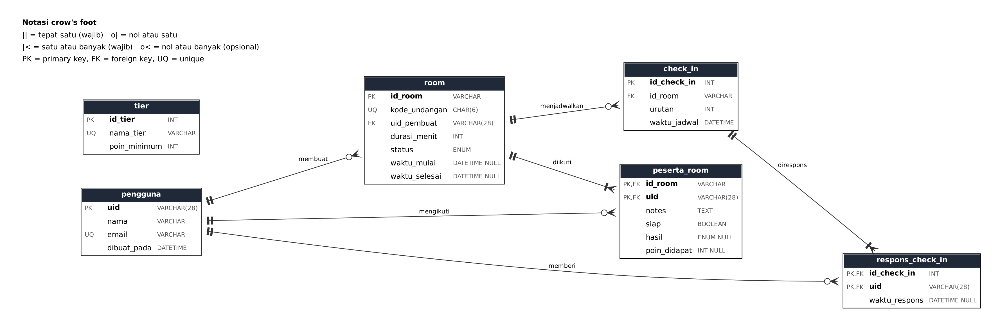

# FokusBareng
 
Web app **Adu Fokus 1v1 real-time** untuk mahasiswa Informatika UII. Dua pemain masuk ke satu room dan menjalankan timer fokus bersama. Selama battle, Random Check-In muncul untuk memastikan keduanya benar-benar ada di depan layar. Pemain yang gagal menjawab, terputus terlalu lama, atau keluar duluan dinyatakan kalah, lalu menanggung konsekuensi yang sudah ditulis pemenang di Notes sebelum battle.
 
Proyek kelompok **E-Duel**, untuk mata kuliah Pengembangan Aplikasi Berbasis Web (SIF302) dan proyek expo Manajemen Pengembangan Teknologi Informasi (MPTI), Informatika FTI UII, semester gasal 2026/2027.
 
> **Status (24 November 2026):** front-end lima fitur wajib selesai dan berjalan dengan data mock. Services Firebase sudah diimplementasikan dan lolos tes di Emulator dengan rules terbuka. Berikutnya: `database.rules.json`, Notes rahasia, dan ketentuan poin (lihat [`docs/usulan-firebase-v1.3.md`](docs/usulan-firebase-v1.3.md)).
 
## Fitur
 
Dikodekan (lingkup MVP):
 
- **Auth**: daftar dan masuk dengan email dan kata sandi.
- **Dasbor Profil dan Gelar**: total poin, gelar, dan riwayat menang, seri, kalah.
- **Lobi Room via tautan undangan**: host membuat room, membagikan tautan, kedua pemain mengisi Notes lalu menekan Siap.
- **Arena Timer dengan wasit otomatis**: timer tersinkron antar perangkat, Random Check-In, deteksi putus sinyal dan tab tidak aktif.
- **Layar Hasil**: menang, kalah (dengan popup Notes pemenang), atau seri.
- **Belajar Mandiri**: fokus sendiri dengan teknik Pomodoro, Fokus panjang, atau Satu blok, Check-In acak opsional, sesi dicatat ke riwayat. Masuk lingkup 24 November 2026; ketentuan poinnya masih dibahas.

Hanya didesain, tidak dikodekan: Pencarian Teman, Add Friend.
 
Di luar proyek: aplikasi native, obrolan, leaderboard, pencarian lawan acak.
 
## Cara main
 
1. Host membuat room dan memilih durasi (15, 25, 45, atau 60 menit).
2. Host membagikan tautan `/room/{roomId}` ke lawan. Satu room maksimal 2 orang.
3. Kedua pemain menulis Notes (konsekuensi untuk yang kalah, 1 sampai 140 karakter), lalu menekan Siap.
4. Battle berjalan. Check-In muncul bersamaan di kedua perangkat dan harus dijawab dalam batas waktu.
5. Battle selesai saat ada yang kalah atau timer habis (seri). Poin dan gelar diperbarui.
Aturan lengkap, termasuk rumus kalah dan toleransi putus sinyal, ada di [`docs/keputusan-aturan.md`](docs/keputusan-aturan.md). Angka seperti batas Check-In, poin, dan ambang gelar masih berstatus **usulan** dan disimpan di satu file config.
 
## Stack
 
| Bagian | Teknologi |
|---|---|
| Front-end | Vue 3, Vite, Vue Router, store berbasis `reactive()` |
| Gaya | CSS biasa dengan custom properties (tanpa Tailwind dan UI library) |
| Back-end | Firebase Authentication dan Realtime Database, paket Spark |
| Wasit | Firebase Security Rules (tanpa Cloud Functions) dan fungsi murni `referee.js` |
| Tes | Vitest, Firebase Emulator Suite |
| Hosting | Vercel atau Firebase Hosting |
 
**Wasit tanpa server.** Paket Spark tidak menyediakan Cloud Functions, jadi prinsipnya: klien mengklaim hasil, Security Rules memeriksa buktinya. Waktu mulai dan respons Check-In memakai waktu server (`ServerValue.TIMESTAMP`), hasil battle hanya bisa ditulis sekali, dan Notes lawan baru bisa dibaca kalau lawan itu menang. Batasan yang diketahui: jadwal Check-In bisa dilihat lewat DevTools, sehingga sistem ini ditujukan untuk mencegah curang kasual.
 
## Menjalankan proyek
 
Butuh Node.js 20 atau lebih baru. Untuk tes rules, butuh Java (dipakai Firebase Emulator).
 
```bash
git clone https://github.com/gustisuryaa/fokusbareng-web.git
cd fokusbareng-web
npm install
cp .env.example .env    # isi config Firebase, lihat di bawah
npm run dev
```
 
Isi `.env`:
 
```bash
VITE_DATA_SOURCE=mock          # mock atau firebase
VITE_FIREBASE_API_KEY=
VITE_FIREBASE_AUTH_DOMAIN=
VITE_FIREBASE_DATABASE_URL=
VITE_FIREBASE_PROJECT_ID=
VITE_FIREBASE_APP_ID=
```
 
Dengan `VITE_DATA_SOURCE=mock`, aplikasi berjalan tanpa Firebase. Mock menyediakan panel dev untuk mensimulasikan lawan (bergabung, siap, terputus, melewatkan Check-In, keluar). Jangan commit file `.env`.
 
Perintah lain:
 
```bash
npm run build           # build produksi
npm test                # tes wasit, mock, dan config
npm run test:emulator   # tes services Firebase di Emulator (butuh Java)
npm run dev:emulator    # aplikasi penuh di atas Firebase Emulator (butuh Java)
```

`npm run dev:emulator` memakai `.env.emulator` (project demo, tanpa akun Firebase). Setiap tab browser menjadi pengguna terpisah, jadi alur 1v1 bisa dicoba di dua tab: daftar dua akun, buat room di tab pertama, buka tautannya di tab kedua. Akun dan room disimpan di `.firebase/emulator-data` saat perintah dihentikan dengan Ctrl+C, lalu dimuat lagi di run berikutnya. Hapus folder itu untuk mulai dari kosong. Akun yang didaftarkan di mode mock (`npm run dev`) tidak ada di Emulator. Rules yang dipakai masih terbuka, jadi mode ini belum menguji keamanan.
 
Mode demo untuk expo (battle 3 menit, Check-In lebih rapat, tanpa poin) direncanakan lewat `?mode=demo` dan masih menunggu keputusan tim.
 
## Struktur repo
 
Sekarang:
 
```
CLAUDE.md                  aturan kerja dan aturan kode proyek
docs/
  keputusan-aturan.md      aturan main, rumus kalah, skenario uji wasit
  struktur-data.md         pohon data Realtime Database dan kontrak services
  design_terbaru.md        token warna, tipografi, aturan visual
  prompt-claude-code-frontend.md
  erd/                     ERD (SQL dan gambar)
  resmi/                   Project Charter, WBS, jadwal, Catatan Perubahan
```
 
Rencana setelah kode masuk:
 
```
src/
  components/      ui, arena, profile, layout
  views/           AuthView, DashboardView, LobbyView, ArenaView, ResultView
  router/
  stores/          authStore, roomStore, battleStore
  services/        mock/ dan firebase/ dengan kontrak yang sama
  domain/          referee.js
  config/          gameRules.js
  styles/          tokens.css, type.css, base.css
database.rules.json
firebase.json
tests/             referee.test.js, rules.test.js
```
 
## Dokumentasi
 
| Butuh tahu | Baca |
|---|---|
| Fitur mana yang masuk lingkup | `docs/resmi/` (Charter, WBS, Catatan Perubahan) |
| Logika permainan dan wasit | [`docs/keputusan-aturan.md`](docs/keputusan-aturan.md) |
| Bentuk data dan fungsi services | [`docs/struktur-data.md`](docs/struktur-data.md) |
| Warna, font, aturan visual | [`docs/design_terbaru.md`](docs/design_terbaru.md) |
| Tampilan setiap layar | Figma, page "Redesign v2" |
| Model data konseptual | [`docs/erd/`](docs/erd/) |
 
Kalau ada yang bertentangan, dokumen resmi di `docs/resmi/` menang soal lingkup, dan Figma "Redesign v2" menang soal tampilan.
 

 
## Tim E-Duel
 
| Nama | Peran |
|---|---|
| Gusti Surya Aditama | Manajer Proyek, UI/UX, Arena Timer, integrasi front-end dan back-end |
| Naufal Allaam Najib | Back-End, database, wasit, sinkronisasi |
| Dzaikra Naqa | Front-End pendukung, QA |
| Dimas Rangga Diza | Anggota |
 
Informatika, Fakultas Teknologi Industri, Universitas Islam Indonesia.
 
